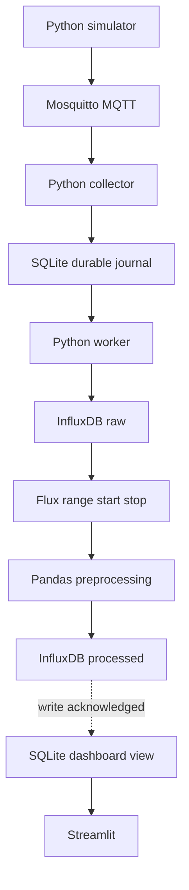

# IoT Assignment — toàn bộ ứng dụng bằng Python

Không cần ESP32 hoặc cảm biến vật lý. Python mô phỏng nhiệt độ, độ ẩm và ánh sáng;
MQTT, InfluxDB và giao diện chạy thực khi dùng Docker. Broker Mosquitto và InfluxDB
là dịch vụ có sẵn, không được viết lại bằng Python.


## 1. Chạy đầy đủ bằng Docker (khuyên dùng để nộp/demo)

Cài Docker Desktop (Windows/macOS) hoặc Docker Engine + Compose v2 (Linux).
Mở terminal tại thư mục chứa `compose.yaml`.


Windows PowerShell:

```powershell
Copy-Item .env.example .env
docker compose up --build -d
```

Lần đầu cần Internet
để tải image và thư viện. Đợi khoảng 30–60 giây sau khi các container khởi động:

- Dashboard: http://localhost:8501
- InfluxDB: http://localhost:8086 — username/password trong `.env`.
- Bucket: `sensors`; organization: `iot-lab`.

```bash
docker compose ps
docker compose logs -f collector worker simulator
```

Ctrl+C chỉ thoát xem log. Để dừng dịch vụ, giữ nguyên dữ liệu:

```bash
docker compose down
```

Khởi động lại bằng `docker compose up -d`. Dữ liệu nằm trong `data/iot.db` và named
volumes của Docker. Không xóa volume hoặc DB trong quá trình demo. Thay `.env` sau
khi InfluxDB đã khởi tạo không tự đổi credential của database cũ.


## 2. Demo nhanh chỉ bằng Python, không cần Docker

Cài Python 3.11 hoặc 3.12. Mở terminal trong thư mục project.

```bash
uv venv --python 3.11
```

Kích hoạt:

```bash
source .venv/bin/activate
```


```bash
uv pip install -r requirements.txt
python -m iot.demo --count 600
python -m streamlit run dashboard.py
```

Mở http://localhost:8501. Demo sinh dữ liệu lịch sử, dùng cùng validation, dedup và
preprocessing, nhưng **bỏ qua MQTT/InfluxDB**. Latency demo được tạo nhân tạo và được
gắn nhãn rõ trên dashboard; không dùng các số này để tuyên bố hiệu năng mạng.
Mỗi lần demo tạo `run_id` mới, chọn phiên tương ứng trên dashboard.

## 3. Chạy các ứng dụng Python trên máy, dịch vụ trong Docker

Tạo `.env` như bước 1, cài thư viện như bước 2, rồi:

```bash
docker compose up --build -d
```
check port 8086 và 8501

## 4. Kiến trúc và nơi chứa code



Worker đọc snapshot journal để đồng bộ raw chưa ghi, sau đó **query raw từ InfluxDB
bằng Flux `range(start, stop)`** làm đầu vào tiền xử lý. Kết quả ghi vào
`processed_sensor_data` rồi upsert vào SQLite để dashboard hiển thị. Nếu query lỗi
hoặc thiếu bản tin của snapshot, worker giữ view cũ và thử lại, không âm thầm
chuyển sang SQLite. Chỉ chế độ offline không có `INFLUX_URL` mới xử lý từ SQLite.

Mặc định worker tự chọn khoảng thời gian từ bin đầu đến hết bin mới nhất của dữ liệu
đã thu; đây là truy vấn có start/stop rõ ràng, chưa phải tối ưu xử lý tăng dần.
Có thể chạy lại một khoảng chỉ định bằng `--once --start ... --stop ...`.
Xem [hướng dẫn truy vấn theo thời gian](docs/TIME_RANGE.md) để chạy và kiểm chứng.

| File | Vai trò |
|---|---|
| `iot/simulator.py` | Tạo số liệu, fault injection, MQTT QoS 1 |
| `iot/collector.py` | Subscribe, commit dữ liệu trước MQTT ACK |
| `iot/validation.py` | Kiểm tra schema, kiểu số, timestamp |
| `iot/ingest.py` | Dùng chung logic nhận dữ liệu cho MQTT và demo |
| `iot/storage.py` | SQLite WAL, dedup, events, state, processed view |
| `iot/preprocess.py` | Missing, outlier, resample, rolling, delta, normalization |
| `iot/influx.py` | Đọc raw theo thời gian; ghi raw/processed, batch 500 points |
| `iot/worker.py` | Khoảng thời gian, context, retry, checkpoint Influx |
| `iot/time_range.py` | Kiểm tra UTC và biên bin 10 giây |
| `iot/metrics.py` | Latency và khoảng trống sequence |
| `dashboard.py` | Biểu đồ cập nhật 3 giây, chỉ số chất lượng, tải CSV |
| `iot/demo.py`, `iot/export.py` | Demo offline, xuất CSV/JSON |
| `tests/test_pipeline.py` | Kiểm thử validation, dedup, cleaning, retry |
| `docs/DEMO_REPORT.md` | Kịch bản demo và khung báo cáo |
| `docs/VALIDATION.md` | Kết quả kiểm thử thực tế và giới hạn |

## 5. Giao thức dữ liệu

Topic `assignment/sensors`, QoS 1, không retained. Payload ví dụ:

```json
{
  "device_id": "python_sensor_01",
  "run_id": "session_abc123",
  "seq": 42,
  "sent_at": 1791350000.125,
  "temperature": 28.6,
  "humidity": null,
  "light": 530.0
}
```

- `sent_at`: UTC Unix seconds, có phần thập phân.
- `device_id` và `run_id`: 1–64 chữ/số/`_`/`-`.
- `seq`: integer không âm; tăng cả khi chủ động bỏ bản tin.
- Sensor `null` hoặc thiếu key: chấp nhận để preprocessing xử lý.
- Chuỗi, boolean, NaN/Infinity: loại, đếm `invalid`.
- Outlier vật lý (ví dụ 95°C): giữ raw, đánh dấu ở bước xử lý.
- Dedup bền vững theo `(device_id, run_id, seq)`, không phụ thuộc restart collector.
- Giờ tương lai quá 5 giây bị loại. Sai lệch đồng hồ nhỏ vẫn có thể tạo latency âm;
  không tự cắt về 0 để che vấn đề đồng bộ giờ.

Simulator mặc định có seed 42. Lịch lỗi theo `seq`:

| Điều kiện | Hành vi |
|---|---|
| `% 17 == 8` | humidity null |
| `% 29 == 12` | temperature 95°C |
| `% 31 == 10` | Bỏ lượt gửi |
| `% 41 == 20` | JSON lỗi |
| `% 37 == 15` | Chờ 800 ms sau khi gắn timestamp |
| `% 43 == 16` | Gửi payload hai lần |

Chạy dữ liệu sạch: `python -m iot.simulator --clean`. Có thể dùng `--count 300`,
`--seed 7`, `--device sensor_02`, `--interval 1`. Gửi thành công được xác nhận bằng
MQTT PUBACK. Nếu không nhận ACK sau 10 giây, simulator dừng với lỗi; Compose restart
và tạo phiên mới. Không tuyên bố exactly-once từ publisher.

## 6. Tiền xử lý

Mỗi thiết bị và phiên chạy được xử lý riêng:

1. Giữ nguyên raw; phát hiện giá trị ngoài miền vật lý và outlier IQR 1.5×.
2. IQR chạy khi có ít nhất 8 giá trị hợp lệ, bỏ kiểm tra thống kê khi IQR gần 0.
3. Đưa outlier về missing rồi lấy trung bình trong bin 10 giây.
4. Nội suy theo thời gian cho tối đa 3 bin trống liên tiếp nằm giữa hai giá trị có thật.
   Không điền các mép hoặc khoảng mất dài. Nếu một bin có cả null và số hợp lệ, lấy
   trung bình số hợp lệ; cột `_missing` vẫn giữ số null gốc.
5. Rolling mean 5 bin, delta giữa hai bin liên tiếp.
6. Min-max theo miền cố định: nhiệt độ [-20,60], ẩm [0,100], ánh sáng [0,2000].

Cờ `_missing`, `_outlier` đếm mẫu raw; `_imputed` đánh dấu bin được điền;
`sample_count` và `empty_bin` phân biệt thiếu toàn bin với thiếu một trường.
Không thay missing chưa xử lý được bằng 0. Khi ghi Influx, mọi numeric processed
có cờ `_valid`: giá trị 0 placeholder với `_valid=false` phải được coi là missing.
Raw null được lưu bằng cờ `<sensor>_missing=true` và không có field số tương ứng.

Đây là phân tích hồi cứu theo phiên: IQR dùng toàn phiên và nội suy có thể dùng mẫu
sau. Khi thêm dữ liệu, kết quả lịch sử có thể đổi. Không dùng cách này để đánh giá
mô hình dự đoán/causal online. Worker tính lại toàn dataset mỗi 5 giây, phù hợp bài
lab vài nghìn đến vài chục nghìn mẫu, không phải triển khai production dài hạn.
`seq` là tag Influx để tránh mất bản tin cùng timestamp; với quy mô lớn cần thiết kế
khác để tránh cardinality cao.

## 7. Chỉ số và khả năng phục hồi

- `latency_ms = (received_at - sent_at) * 1000`: trễ publisher → collector.
  Có mean, P95, max. Không phải latency end-to-end đến trình duyệt.
- `to_processed_*`: trễ từ publisher đến lần đầu worker hoàn tất ghi Influx processed
  và chuẩn bị commit view dashboard, gồm thời gian chờ batch/retry; chưa gồm render UI.
  Trong demo lịch sử, chỉ số này không có ý nghĩa benchmark.
- Tuổi mẫu mới nhất tại lần dựng UI là chỉ báo độ tươi; bao gồm thời gian chờ,
  không phải phép đo thời gian render hoàn tất.
- `sequence_gaps` chỉ đếm khoảng giữa seq đầu và cuối đã nhận trong từng phiên.
  Không phát hiện missing ở đầu/cuối; bao gồm JSON lỗi và chủ động skip, không
  suy diễn tất cả thành mất gói MQTT.
- SQLite journal commit trước ACK, broker persistent session + QoS1 giúp gửi lại
  khi collector mất kết nối. Bản trùng được ghi events nhưng không nhân đôi raw.
- Khi Influx lỗi, journal tiếp tục nhận; worker giữ checkpoint và thử lại mỗi 5 giây.
  View processed chỉ refresh sau khi ghi Influx thành công. UI hiển thị worker error.
- Influx replay cùng point key là idempotent. Không có transaction xuyên SQLite/Influx;
  batch Influx có thể hiện một phần khi đang retry.
- Broker khởi động lần đầu trước khi collector subscribe có thể khiến vài message đầu
  không có người nhận. Đợi log `Subscribed` rồi restart simulator nếu cần phiên đo đầy đủ.
- Chỉ chạy một collector với ID mặc định và một worker. Journal không tự prune.

## 8. Xuất dữ liệu và kiểm thử

```bash
python -m unittest discover -s tests -v
python -m iot.export
```

Hoặc trong Docker:

```bash
docker compose exec worker python -m iot.export
```

CSV và JSON nằm ở `data/export/`. Dashboard cũng có nút tải CSV cho phiên đã chọn.
`sample_output/` đi kèm là kết quả demo offline thật đã chạy lúc tạo project,
**không phải benchmark MQTT**. Xem `docs/VALIDATION.md` để biết phạm vi đã kiểm thử.

